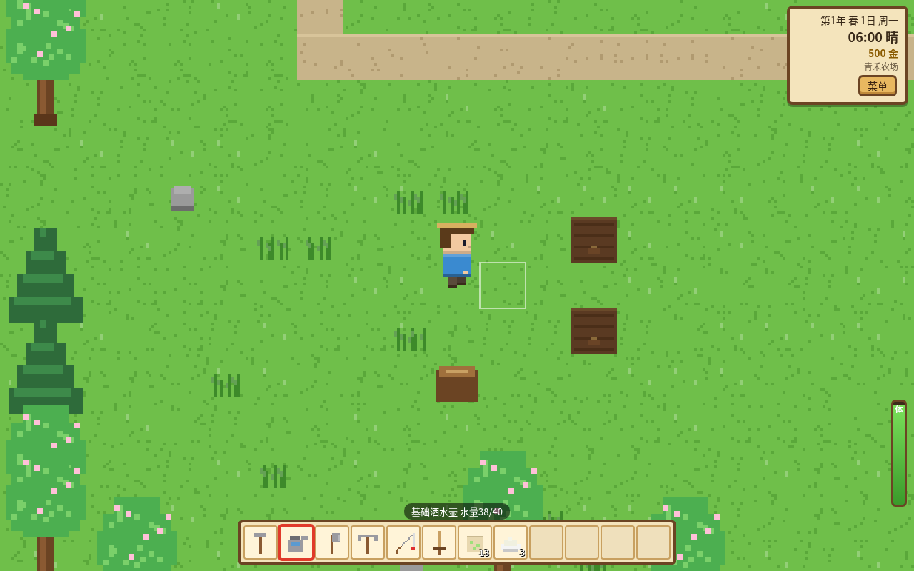

# 溪谷小农场

在浏览器里玩的像素田园生活游戏：开垦荒地、种菜浇水、钓鱼、下矿、养鸡养牛、和镇上的村民交朋友，一年四季慢慢经营自己的小农场。

**在线游玩：** https://ysdtn.com/vibe-farm/

纯前端（HTML + Canvas + 原生 JS），不联网、不需要账号，存档保存在你自己的浏览器里，桌面和手机都能玩。

> 本作是**非商业的同人致敬作品**，玩法灵感来自《星露谷物语》（Stardew Valley）。游戏里的全部像素美术（由代码程序化绘制）、音乐与音效（WebAudio 实时合成）、角色、地名、对话与文本都是原创，没有使用原作的任何素材、文字、角色名或音频，也没有复用其他项目的代码。



## 操作

| 动作 | 键盘鼠标 | 手机 |
|---|---|---|
| 移动 | WASD / 方向键 | 左下虚拟摇杆 |
| 使用工具/物品（锄地、浇水、砍树、挖矿、抛竿、挥剑、播种、施肥、放置） | 鼠标左键（指向身边格子）/ 空格 / J，按住可连续使用 | “使用”按钮 |
| 互动（对话、送礼、收获、开箱、出货、进门、下梯子） | 鼠标右键 / E / K | “互动”按钮，或点击身边的格子 |
| 钓鱼小游戏 | 按住左键/空格让绿色条上升，把鱼框在条里 | 按住“使用” |
| 切换快捷栏 | 1–9、0、-、= / 滚轮 | 点快捷栏 |
| 菜单（背包/制作/好感/收藏/日历/系统） | Tab / I / Esc | “菜单”按钮 |
| 吃东西 | 选中食物后使用，或在背包里“食用” | “吃”按钮 |

走进商店的门（面朝门撞一下）即可打开商店；走进房子门口可以睡觉。

## 已实现的内容

- **种田**：锄地、播种、浇水、施肥（基础/优质肥料、催生剂），21 种季节作物（春 7、夏 6、秋 7、冬 1，玉米/向日葵跨夏秋），草莓、番茄、蓝莓、葡萄等 9 种可重复收获；作物品质（普通/银星/金星）；洒水器（十字 4 格）和高级洒水器（周围 8 格）每天早上自动浇水；雨天自动浇水；换季时不属于新季节的作物会枯死；储物箱。
- **时间与日历**：早上 6:00 到凌晨 2:00，现实约 7 秒 = 游戏 10 分钟（可调 0.5×–2×）；凌晨 2 点没睡会晕倒并损失 10% 金钱（最多 1000）；四季各 28 天；晴/雨/雷雨/雪；睡觉自动存档并显示前一天的出货结算。
- **体力与工具**：锄头、洒水壶、斧头、镐子可在铁匠铺升级到铜/铁/金（范围更大、威力更强；大木桩要铜斧，大石头要铜镐）；钓竿在渔具店升级（钓鱼条更宽）；剑有 4 档。
- **采集与林木**：每季 3 种野外采集物 + 海滩贝壳/珊瑚/海螺/海草；橡树、松树可砍伐（木材、树液、种子），镇上树木砍倒 10 天后再生；农场每天会冒出杂草、石头、树枝；种下橡子/松果可以长成树。
- **钓鱼**：河、湖（农场池塘）、海、矿井地下湖四种水域，22 种鱼，按季节、时段、天气出现，难度和游动方式各不相同；完美钓起得金星品质；鱼饵缩短等待时间。
- **矿井**：40 层随机生成洞穴，铜/铁/金矿、煤炭、8 种宝石、6 种古物；梯子藏在石头下或清光怪物后出现；5 种怪物（史莱姆、蝙蝠、霜史莱姆、石像、赤史莱姆），剑战斗、击退、受伤与在矿井被击倒；每 5 层解锁电梯；第 40 层有宝箱；可以制作“矿井楼梯”直接下一层；熔炉冶炼矿锭。
- **动物**：在木匠铺建鸡舍/畜棚，购买鸡、奶牛、绵羊（可起名）；晴天动物在户外吃草，否则每晚吃饲料槽里的干草；抚摸增加好感，好感高的鸡会下大鸡蛋；产出鸡蛋、牛奶、羊毛。
- **小镇**：杂货店（种子、肥料、背包扩容）、铁匠铺（矿石、工具与剑升级）、木匠铺（材料、建筑、动物、干草、房屋升级）、渔具店（鱼饵、钓竿）、博物馆（捐赠宝石与古物，4 档奖励）。各店有营业时间。
- **村民**：10 位原创村民（林夏、铁山、柏木、海伯、小满、顾远、苏晴、石头、王奶奶、周伯），按时段在镇上走动（寻路），雨天待在固定地点，晚上回家；每天对话 + 随季节、天气、好感变化的台词；每人有最爱/喜欢/讨厌的礼物，每天 1 次、每周 2 次，生日礼物 8 倍；10 颗心好感；好感页会记录你发现的喜好。
- **节日（每季一个）**：春 13 日寻蛋会（60 秒找彩蛋）、夏 11 日汤锅节（加一样食材，影响全镇好感）、秋 16 日丰收展览会（挑 6 件展品评分领奖金）、冬 8 日冰湖钓鱼赛（120 秒内钓鱼比赛）。
- **制作与烹饪**：11 种制作配方（箱子、洒水器、熔炉、肥料、鱼饵、楼梯、能量饭团、石板路等）；房屋升级出厨房后可做 10 道料理。
- **出货与收藏**：出货箱夜间结算并显示明细；收藏页记录出货、鱼类、博物馆捐赠和料理。
- **存档**：localStorage 自动存档（每晚睡觉）；系统页可导出/导入 JSON 备份；标题画面、新游戏（自定名字与农场名）、继续、设置（音乐/音效/时间流速）。
- **原创音乐**：每个季节一段由代码作曲、WebAudio 实时演奏的循环曲，矿井里换成低沉版本；所有音效同样实时合成。

## 没有做 / 简化了的部分

- 没有技能等级与职业、任务板/社区中心类的收集任务、结婚与过场剧情、加工机器（只有熔炉）、作物巨大化、乌鸦与稻草人、温室、马。
- 动物没有室内地图：鸡舍/畜棚是菜单式管理；动物晴天在农场院子里走动。
- 商店和村民家没有室内场景，走进门直接打开商店界面。
- 村民日程是“简化版”：每人 3–4 个时段的目标点。
- 工具升级立即完成，不需要等两天。
- 所有料理配方一开始就会做（需要厨房）。

## 本地运行与测试

直接用任意静态服务器打开根目录（例如 `python3 -m http.server`）即可。

自动化测试（需要 Chrome 和 puppeteer-core）：

```bash
node tests/play.js     # 开垦/播种/浇水/睡觉/收获/出货、钓鱼、矿井下行与电梯、战斗、送礼、熔炉、工具升级、动物、四个节日、一整年模拟、2点晕倒、存档读档、手机摇杆与按钮
node tests/fishbot.js  # 用简单控制器测试不同难度鱼的可钓性
```

截图在 `screenshots/` 目录。

## 许可

代码以 MIT 许可发布。本作为非商业同人作品，与原作开发商无关。
